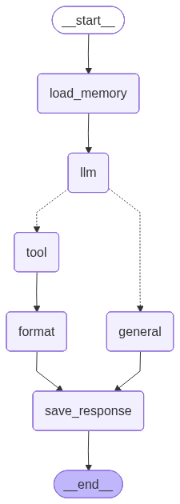

# AI-Powered Inventory Intelligence System

An advanced Autonomous Agent built with LangGraph and Google Gemini to interact with inventory databases. It generates SQL queries and provides data-driven insights.

---

## System Architecture

The system follows a modular workflow:

1. Orchestration Layer (LangGraph)  
2. Reasoning Engine (Google Gemini)  
3. Data Access Layer (Supabase)  
4. Interface Layer (CLI + API)  

---

## Key Features

- Natural Language to SQL  
- Safe Data Access (SELECT only)  
- Stateful Conversations  
- Error Handling  
- Production Ready  

---

## Project Structure

```text
├── Agents/               # Graph logic & nodes
├── DB_Management/        # DB connection & queries
├── models/               # LLM config & prompts
├── Tools/                # SQL tools
├── config/               # Environment settings
├── AI_Inventory_Assistant_app.py  # Main app
├── main.py               # CLI
├── api.py                # API server
```

---

## Flow



---

## Setup & Installation

```bash
cd inventory-management-system/chatbot

python -m venv .venv
.venv\Scripts\activate

pip install -r requirements.txt
```

---

## Run

CLI:
```bash
python main.py
```

API:
```bash
python api.py
```

---

## Local Server

| Service | URL |
|--------|-----|
| API | http://localhost:8002 |
