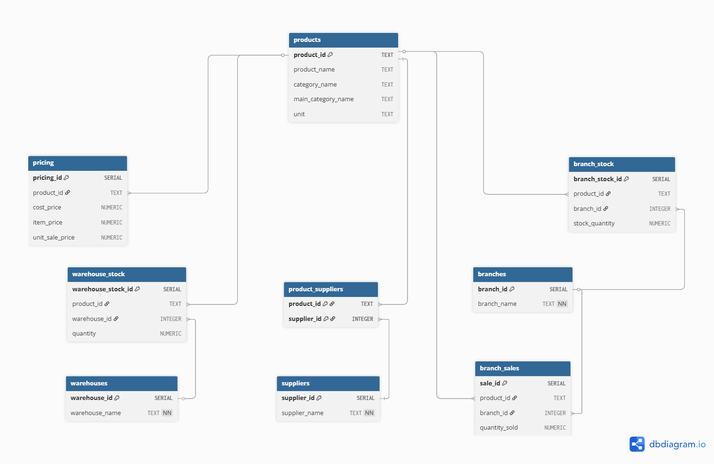

# Inventory Normalization ETL

ETL pipeline that reads Arabic inventory CSV files, normalizes the data, and loads it into PostgreSQL.

## What it does

- Reads the source CSV files
- Cleans Arabic inventory data
- Normalizes products, suppliers, branches, warehouses, stock, sales, and pricing
- Converts branch sales/stock columns from wide format to relational rows
- Creates PostgreSQL tables, constraints, and indexes
- Exports a database backup/report after loading

## Database tables

- `products`
- `suppliers`
- `product_suppliers`
- `branches`
- `branch_sales`
- `branch_stock`
- `warehouses`
- `warehouse_stock`
- `pricing`

## Requirements

- Python 3.8+
- PostgreSQL installed and running
- Project files:
  - `etl_pipeline.py`
  - `requirements.txt`
  - source CSV files

## Setup

Create and activate a virtual environment:

### Windows

```bash
python -m venv .venv
.venv\Scripts\activate
```

### macOS / Linux

```bash
python3 -m venv .venv
source .venv/bin/activate
```

Install dependencies:

```bash
pip install -r requirements.txt
```

## Database configuration

Open `etl_pipeline.py` and update the PostgreSQL credentials:

```python
DB_CONFIG = {
    'host': 'localhost',
    'port': 5432,
    'user': 'postgres',
    'password': 'YOUR_PASSWORD_HERE',
    'database': 'normalized_inventory_db'
}
```

## Run

```bash
python etl_pipeline.py
```

## Output

The pipeline may generate:

- `normalized_inventory_db.backup`
- `normalized_inventory_db.sql`
- `etl_summary_report.txt`

## Restore database backup

From `.backup`:

```bash
pg_restore -U postgres -d normalized_inventory_db normalized_inventory_db.backup
```

From `.sql`:

```bash
psql -U postgres -d normalized_inventory_db -f normalized_inventory_db.sql
```

## Notes

- CSV files should be UTF-8 encoded.
- Make sure PostgreSQL is running before running the script.
- If `pg_dump` or `pg_restore` is not found, add PostgreSQL `bin` folder to your system PATH.

## Database Schema Diagram

